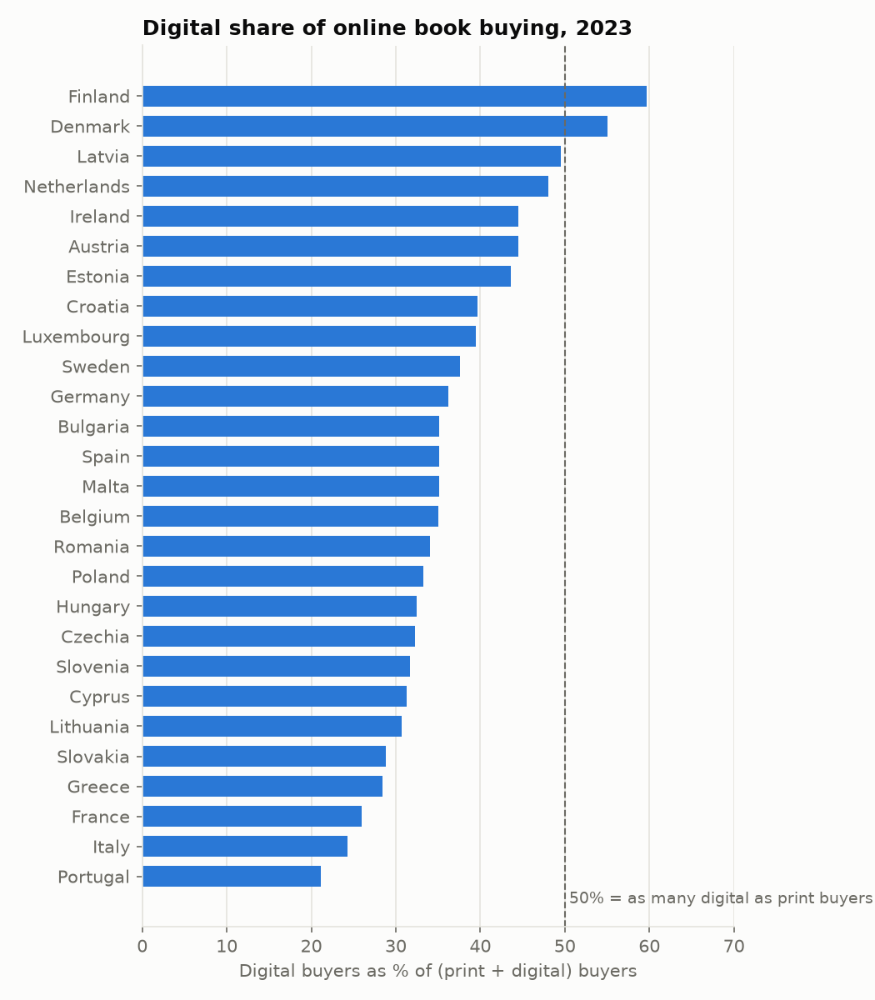
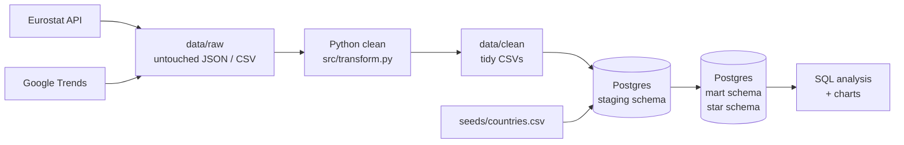
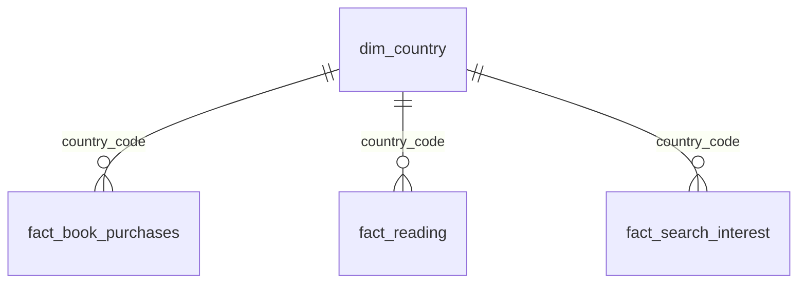

# EU Print vs Digital

A data pipeline comparing print vs digital reading across the EU.

It pulls official statistics from the Eurostat API and search data from Google Trends, cleans them with Python, loads them into PostgreSQL (in Docker), and models them as a star schema for SQL analysis.

## Key findings

- **Print still wins in most of the EU.** In 2023, more people bought printed books online than e-books in 25 of 27 countries. Only Finland (60% of online book buyers chose digital) and Denmark (55%) lean digital. Portugal (21%) and Italy (24%) lean most towards print.
- **There is a clear north–south divide.** 16.7% of people in Nordic countries bought e-books online in 2023, compared with 4.7% in Southern and 4.4% in Central-Eastern Europe.
- **Countries that read more also buy more e-books.** In 2022, the share of people who read at least one book and the share who bought e-books had a correlation of 0.75 across 26 countries.



More charts: [e-book buying by region](docs/ebooks_by_region.png) · [Google search interest by year](docs/search_interest.png)

## Architecture



| Step | File | What it does |
|---|---|---|
| Extract | `src/extract.py`, `src/extract_trends.py` | Downloads Eurostat datasets and Google Trends, and saves them untouched in `data/raw/` |
| Transform | `src/transform.py` | Parses JSON-stat, keeps the EU27 countries, renames columns, fixes types and reshapes Trends from wide to long |
| Load | `src/load.py` | Writes each clean CSV to a `staging` table |
| Model | `sql/build_model.sql` | Builds the `mart` star schema from staging |
| Orchestrate | `src/pipeline.py` | Runs all of the above in order |

The load step is **idempotent**: every table is dropped and rebuilt on each run, so running the pipeline twice gives the same row counts as running it once, with no duplicates.

## How to run

You need Docker and Python 3.

```bash
cp .env.example .env              # then choose your own password in .env
docker compose up -d              # starts Postgres 16
python3 -m venv .venv && source .venv/bin/activate
pip install -r requirements.txt
python src/pipeline.py            # extract → transform → load → model
python src/charts.py              # saves the charts in docs/
pytest                            # data quality tests
```

The analysis queries are in `sql/analysis/`. Each starts with a comment saying what it answers and what it found.

## Data model



| Table | Type | Grain (what one row means) |
|---|---|---|
| `mart.dim_country` | Dimension | One EU country, with its name, region (Nordic, Western, Southern, Central-Eastern) and euro membership |
| `mart.fact_book_purchases` | Fact | One country, one year, one indicator (% of people who bought print or digital books online) |
| `mart.fact_reading` | Fact | One country, one year, one sex, one age group, one "books read" group (% of people) |
| `mart.fact_search_interest` | Fact | One country, one week, one Google search keyword (interest 0–100) |

## Data sources

| Source | Dataset | Used for |
|---|---|---|
| Eurostat | `isoc_ec_ibgs` | Internet purchases: printed books vs e-books (2020–2025) |
| Eurostat | `ilc_scp27` | Number of books read in the last 12 months (2022) |
| Google Trends (via `pytrends`) | Kindle, e-reader | Weekly search interest in e-reading in 10 EU countries over the last 5 years |

## Challenges

- **Parsing JSON-stat.** Eurostat returns a single flat list of values plus dimension sizes, not a table. I wrote a parser that turns each value's position back into its country, year and indicator, like reading an odometer.
- **Country codes.** Eurostat uses `EL` for Greece, not the ISO code `GR`, and mixes EU aggregates (`EU27_2020`, `EA20`) in with countries. The cleaning step filters to an explicit EU27 list.
- **Changed indicator codes.** In 2024 Eurostat replaced the e-book indicator (`I_BBOOKNLS`) with a new definition (`I_BBOOK2`). Comparisons over time use 2020–2023 so that they compare like with like.
- **Google Trends blocking.** Google returns HTTP 429 (too many requests) after a few calls. The extract waits between countries, skips countries it has already downloaded, and stops cleanly on a 429 so the pipeline can be run again later to fill the gaps.
- **Library changes.** SQLAlchemy 2.1 changed its default Postgres driver, so the connection URL names `psycopg2` explicitly.

## Limitations

- **The purchase data only covers online buying.** Books bought in shops or borrowed from libraries are not counted, so print is probably under-represented.
- **The reading survey covers one year only (2022)**, and Germany has no values.
- **The reading survey counts books, not formats.** It shows how much people read, not whether they read in print or digitally.
- **Trends shows search interest, not sales.** Scores are scaled 0–100 within each country, so the analysis compares changes over time, not levels between countries. English keywords miss local-language searches (such as "E-Book-Reader" or "liseuse"), and there is no print keyword to compare against.
- **The print vs digital split changed in 2024**, so 2023 → 2024 is not a like-for-like comparison.
